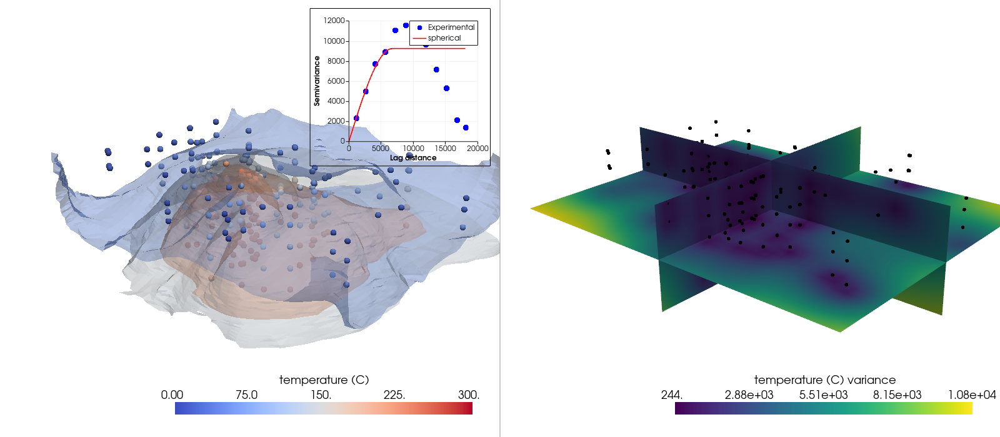
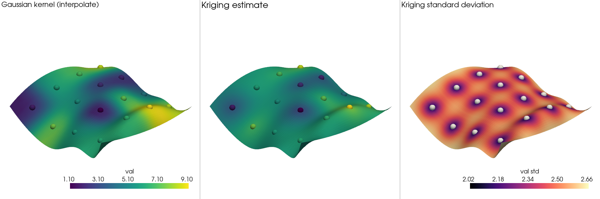
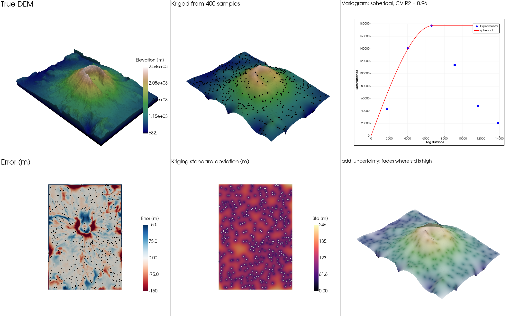

# pyvista-krige

Kriging for [PyVista](https://pyvista.org) datasets, powered by
[PyKrige](https://github.com/GeoStat-Framework/PyKrige).

Installing the package adds a `krige` namespace to every PyVista dataset and
plotter through PyVista's
[extension mechanism](https://docs.pyvista.org/extras/extending_pyvista.html).
No import is needed.

```bash
pip install pyvista-krige            # ordinary and universal kriging, 2D and 3D
pip install "pyvista-krige[all]"     # + GSTools models, regression/classification kriging, CV
```

## Usage

```python
import pyvista as pv
from pyvista import examples

probes = examples.download_thermal_probes()  # 245 points with 'temperature (C)'

# Fit once, predict onto any dataset.
model = probes.krige.fit('temperature (C)', variogram_model='spherical')
grid = pv.ImageData(
    dimensions=(30, 38, 50), spacing=(500, 500, 100), origin=(329700, 4252600, -2700)
)
kriged = model.predict(grid, n_closest_points=24)
kriged['temperature (C) variance']  # kriging variance at every point

# Or krige straight onto an image spanning the samples.
image = probes.krige.to_image('temperature (C)', dimensions=(40, 40, 20))

pl = pv.Plotter()
pl.add_mesh(kriged.contour(5, scalars='temperature (C)'), opacity=0.5)
pl.krige.add_variogram(model, loc=(0.62, 0.62), size=(0.36, 0.36))
pl.show()
```

## Gallery

Each image comes from a script in [`examples/`](examples/) that runs on one of
PyVista's built-in datasets. To regenerate them, run
`python examples/render_gallery.py`.

### Subsurface temperature in 3D

[`examples/thermal_probes.py`](examples/thermal_probes.py): 245 thermal probes kriged onto a
57,000-point volume. The left panel shows temperature contours with the fitted variogram as
an inset (`pl.krige.add_variogram`). The right panel shows the kriging variance, which is
low near the probes and grows away from them.



### Kriging compared with Gaussian-kernel interpolation

[`examples/saddle_comparison.py`](examples/saddle_comparison.py): the data from PyVista's
interpolation example. Both methods honor the samples. Kriging reverts smoothly toward the
mean between samples and also reports its uncertainty.



### Mount St. Helens from 400 spot elevations

[`examples/st_helens.py`](examples/st_helens.py): `cross_validate` picks the variogram
(spherical, R² = 0.96), which is then kriged back onto the full 152,000-point DEM with
`n_closest_points=24`. The panels show the true and kriged terrain, the variogram, the
error, the kriging standard deviation, and `pl.krige.add_uncertainty`.



### What maps to what

| PyKrige | pyvista-krige |
| --- | --- |
| `OrdinaryKriging`, `UniversalKriging`, `OrdinaryKriging3D`, `UniversalKriging3D` | `dataset.krige.fit(scalars, method=..., dim=...)`. 2D or 3D is detected from the samples. |
| `execute('grid' / 'points' / 'masked')` | `model.predict(target)`. The fast grid path is used for axis-aligned `ImageData` and `RectilinearGrid`. Use `where=` to krige a subset. |
| variogram fit, `lags`, `semivariance` | `model.variogram`, `pl.krige.add_variogram(model)` |
| `get_statistics`, `get_epsilon_residuals` | `model.statistics` |
| `update_variogram_model` | `model.with_variogram(...)`, which returns a new model |
| drift terms | `specified_drift=['array name']`, `external_drift=<ImageData>` |
| GSTools `CovModel` | `variogram_model=gs.Matern(dim=3, ...)` |
| `RegressionKriging`, `ClassificationKriging` | `dataset.krige.regression(...)`, `dataset.krige.classify(...)` |
| `Krige` + `GridSearchCV` | `dataset.krige.cross_validate(scalars, param_grid)` |

Results follow PyVista's filter conventions:
- A new dataset is returned, and the input is never modified.
- The estimate goes in `point_data[scalars]` and the variance in `point_data['<scalars> variance']`.
- Points skipped with `where=` get `null_value`, and a `vtkValidPointMask` array is written.

### Memory

Without `n_closest_points`, PyKrige builds a dense distance matrix between every
target point and every sample. `predict` raises an error before that matrix would
exceed `max_memory` (1 GB by default). Pass `n_closest_points` to krige from a
moving window instead.

## Development

```bash
pip install -e ".[all]" pytest
pytest
```

## License

MIT
