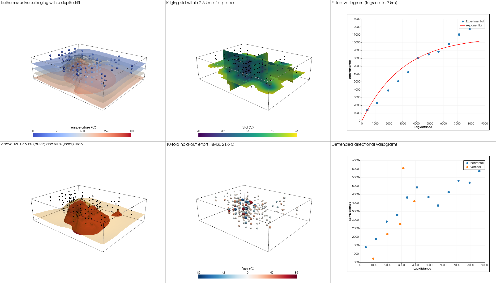
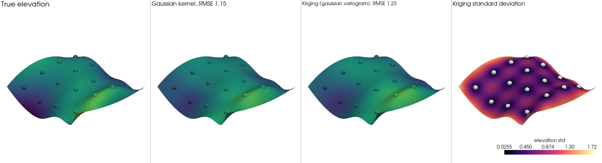
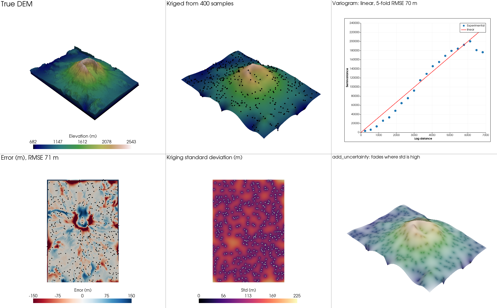

# pyvista-krige

Kriging for [PyVista](https://pyvista.org) datasets, powered by
[PyKrige](https://github.com/GeoStat-Framework/PyKrige).

Installing the package adds a `krige` namespace to every PyVista dataset and
plotter through PyVista's
[extension mechanism](https://docs.pyvista.org/extras/extending_pyvista.html).
No import is needed.

```bash
pip install pyvista-krige            # ordinary and universal kriging, 2D and 3D
pip install "pyvista-krige[all]"     # + GSTools models, regression/classification kriging, CV
```

## Usage

```python
import pyvista as pv
from pyvista import examples

probes = examples.download_thermal_probes()  # 245 points with 'temperature (C)'

# Temperature rises with depth, so krige with a depth drift (universal kriging).
probes['depth'] = probes.points[:, 2]
model = probes.krige.fit(
    'temperature (C)',
    method='universal',
    specified_drift=['depth'],
    variogram_model='exponential',
    max_lag=9000.0,  # fit the variogram to the short lags only
)
grid = pv.ImageData(
    dimensions=(30, 38, 50), spacing=(500, 500, 100), origin=(329700, 4252600, -2700)
)
grid['depth'] = grid.points[:, 2]
kriged = model.predict(grid)  # kriged in memory-bounded chunks
kriged['temperature (C) variance']  # kriging variance at every point

# Score the model on held-out probes.
holdout = model.cross_validate(10)
print(holdout.rmse)

# Or krige straight onto an image spanning the samples.
image = probes.krige.to_image('temperature (C)', dimensions=(40, 40, 20))

pl = pv.Plotter()
pl.add_mesh(kriged.contour(5, scalars='temperature (C)'), opacity=0.5)
pl.krige.add_exceedance(kriged, 'temperature (C)', 150.0, probability=0.9)
pl.krige.add_variogram(model, loc=(0.62, 0.62), size=(0.36, 0.36))
pl.show()
```

## Gallery

Each image comes from a script in [`examples/`](examples/) that runs on one of
PyVista's built-in datasets. To regenerate them, run
`python examples/render_gallery.py`.

### Subsurface temperature in 3D

[`examples/thermal_probes.py`](examples/thermal_probes.py): 245 thermal probes kriged onto a
57,000-point volume. Temperature rises steadily with depth, so ordinary kriging, which
reverts to the mean away from the probes, bends the isotherms back at the edges of the
volume. Universal kriging with a depth drift follows the gradient instead. When the 69
deepest probes are predicted from the rest, the error drops from 55.7 °C (ordinary
kriging) to 24.7 °C. The top row shows the isotherms, the kriging standard deviation within
2.5 km of a probe (`max_distance`), and the fitted variogram. The bottom row shows the regions
above 150 °C at 50 % and 90 % probability (`pl.krige.add_exceedance`), the 10-fold hold-out
errors (`pl.krige.add_residuals`), and horizontal and vertical variograms of the depth-trend
residuals (`samples.krige.variogram(direction=..., detrend=True)`).



### Kriging compared with Gaussian-kernel interpolation

[`examples/saddle_comparison.py`](examples/saddle_comparison.py): the 16 sparse points and
saddle surface from PyVista's interpolation example, with the points' elevation
interpolated back onto the surface and scored against the true elevation. Leave-one-out
cross-validation (`model.cross_validate('loo')`) picks a gaussian variogram. Kriging is
about as accurate as the best kernel radius (RMSE 1.23 against 1.15), and it also shows
where it is unsure.



### Mount St. Helens from 400 spot elevations

[`examples/st_helens.py`](examples/st_helens.py): 5-fold cross-validation picks the
variogram, fitted to 20 lags up to 7 km. The elevation is then kriged back onto the full
152,000-point DEM against all 400 samples, in memory-bounded chunks. The largest errors
are along the border, where every estimate is extrapolated from samples on one side. The
panels show the true and kriged terrain, the variogram, the error, the kriging standard
deviation, and `pl.krige.add_uncertainty`.



### What maps to what

| PyKrige | pyvista-krige |
| --- | --- |
| `OrdinaryKriging`, `UniversalKriging`, `OrdinaryKriging3D`, `UniversalKriging3D` | `dataset.krige.fit(scalars, method=..., dim=...)`. 2D or 3D is detected from the samples. |
| `execute('grid' / 'points' / 'masked')` | `model.predict(target)`. The fast grid path is used for axis-aligned `ImageData` and `RectilinearGrid`. Use `where=` to krige a subset. |
| variogram fit, `lags`, `semivariance` | `model.variogram`, `pl.krige.add_variogram(model)` |
| `get_statistics`, `get_epsilon_residuals` | `model.statistics` |
| `update_variogram_model` | `model.with_variogram(...)`, which returns a new model |
| drift terms | `specified_drift=['array name']`, `external_drift=<ImageData>`. The matching `drift_terms` entry is added for you. |
| GSTools `CovModel` | `variogram_model=gs.Matern(dim=3, ...)` |
| (not in PyKrige) variogram of the drift residuals | `fit(..., method='universal', detrend=True)` |
| (not in PyKrige) fit only short lags | `fit(..., max_lag=...)` |
| (not in PyKrige) directional variograms | `dataset.krige.variogram(scalars, direction='vertical')`, `.fit(model)` |
| (not in PyKrige) k-fold / leave-one-out scoring of any model | `model.cross_validate(5)` or `'loo'`, `pl.krige.add_residuals(holdout)` |
| (not in PyKrige) extrapolation limits | `predict(..., max_distance=..., max_std=...)` |
| (not in PyKrige) exceedance probability | `pyvista_krige.exceedance(result, scalars, threshold)`, `pl.krige.add_exceedance(...)` |
| (not in PyKrige) anisotropy geometry | `pl.krige.add_anisotropy_ellipsoid(model)` |
| `RegressionKriging`, `ClassificationKriging` | `dataset.krige.regression(...)`, `dataset.krige.classify(...)` |
| `Krige` + `GridSearchCV` | `dataset.krige.cross_validate(scalars, param_grid)` |

Results follow PyVista's filter conventions:
- A new dataset is returned, and the input is never modified.
- The estimate goes in `point_data[scalars]` and the variance in `point_data['<scalars> variance']`.
- Points skipped with `where=`, `max_distance=` or `max_std=` get `null_value`, and a `vtkValidPointMask` array is written.

### Memory

Without `n_closest_points`, PyKrige builds a dense matrix between the target points and
every sample. `predict` kriges in chunks small enough to keep that matrix under
`max_memory` (1 GB by default). Grids are split into z-slabs (y-rows in 2D), so they keep
PyKrige's fast grid path. This matters most for universal kriging, which has no moving
window. `max_memory=None` kriges everything in one call.

## Development

```bash
pip install -e ".[all]" pytest
pytest
```

## License

MIT
